# 磁共振预习 MRI Rehearsal

> **v0.1.3 预发布草稿：模拟器 QA 通过（QA #8），真机未验证。** v0.1.3 pre-release draft: passed emulator QA (#8), not yet verified on a headset.
>
> 这是一个预习练习，**不是医疗器械**；扫描当天请以医院和技师的指引为准。
> This is a rehearsal, **not a medical device**; on the day, follow your hospital's instructions.

## 安装 / Install

先在本机构建 debug 包，连上头显后安装：
Build the debug APK locally, connect the headset, then install:

```bash
./gradlew assembleDebug
adb install -r app/build/outputs/apk/debug/app-debug.apk
pico-cli app launch io.embodit.mrirehearsal
```

头显上如果装过别的电脑签名的旧版，`install -r` 会报 `INSTALL_FAILED_UPDATE_INCOMPATIBLE`，先 `adb uninstall io.embodit.mrirehearsal` 再装。
If an older build signed on another computer is installed, `install -r` fails with `INSTALL_FAILED_UPDATE_INCOMPATIBLE`; run `adb uninstall io.embodit.mrirehearsal` first.

Release 上的 `MriRehearsal-v0.1.3-unsigned.apk` 是 assembleRelease 未签名包，给上架用，不能直接装。
`MriRehearsal-v0.1.3-unsigned.apk` on the release is the unsigned assembleRelease build for the store listing; it cannot be installed as is.

需要 PICO OS 6（Spatial SDK 6.1.9），Full Space（Progressive，沉浸度 100 / 40 / 100）。
Requires PICO OS 6 (Spatial SDK 6.1.9); Full Space (Progressive, immersion 100 / 40 / 100).

<p align="center">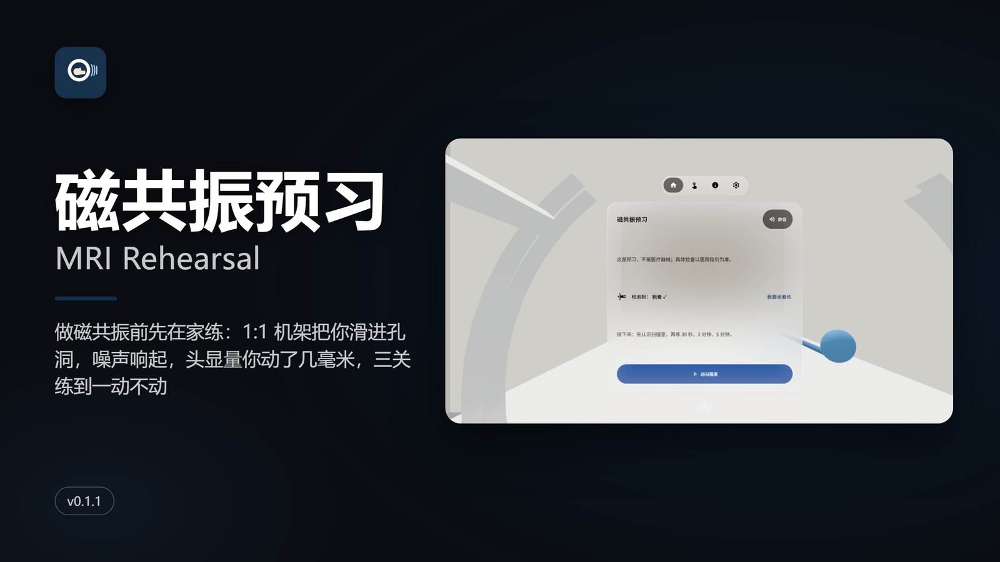</p>

## 中文

做磁共振之前，先在家练一遍。躺在自己床上（或坐着），一台 1:1 的磁共振机把你滑进 60 cm 的孔洞，扫描噪声响起，头显量你的头动了几毫米、几度。先认识扫描室，再按 30 秒 → 2 分钟 → 5 分钟三关，练到一动不动。

- **认识扫描室**：机架、孔洞、头线圈、呼叫球和技师窗依次亮起，窗口一站一站讲清楚
- **三关练静止**：入舱滑入 → 定位倒计时 → 几段扫描序列（中间有间歇，字幕提前说「下一段更响 / 差不多 / 轻一点」）
- **随时呼叫技师**：捏住 0.4 秒（或手柄扳机按住），扫描停、台子滑出，给「继续扫描 / 重来这一关 / 出舱结束」
- **结果**：静止分 + 等级 + 时间线标出动的那几下，给下一关或再来一次
- **一个系统窗口**：原生页签（扫描 / 怎么操作 / 关于 / 设置），用窗口下方的系统控件拖动、关闭；关掉后点场景里的「打开面板」小牌、或按返回键 / 手柄 B 重新打开
- **设置**：叫回面前、退出应用；中英文、孔径 60 / 70 cm、动了提醒、头线圈、跳过进出动画、三档音量；静音一眼可见并记住
- 不联网、不需要账号、不申请权限

### v0.1.3 改了什么

- 真机反馈「头上方的机架 / 孔洞位置不对」→ 开始扫描、重来时按当时的头姿重取孔洞位置，坐着进扫描室再躺下，机架也跟到头顶方向（v0.1.2）
- 躺进孔里时，读数条四角会插进孔壁 → 按四个角解读数条高度（60 / 70 cm、躺 / 坐、头偏 ±3 cm 都离孔壁 ≥ 1.5 cm），条离眼约 0.27 m
- 模拟器 QA 第 8 轮通过；真机未验证

| | |
|---|---|
| 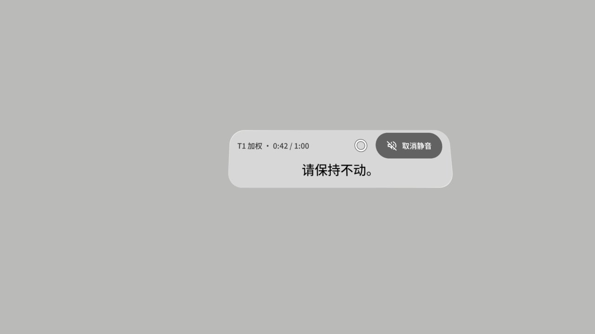 躺在孔里：读数条四角完整，不插进孔壁 | 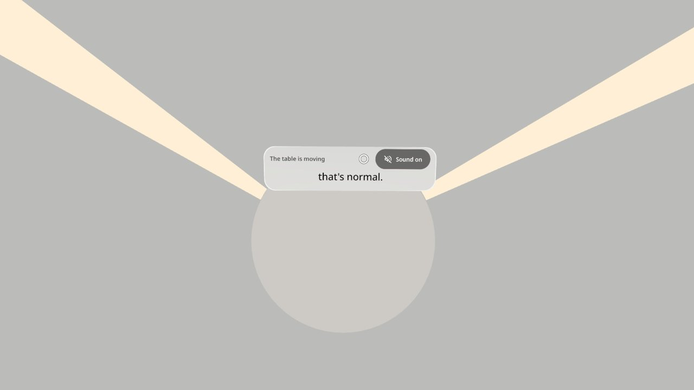 坐姿滑入：条在孔里，四角完整 |

### v0.1.1 改了什么

- 换成原生系统窗口 + 原生页签，系统拖动 / 关闭，删掉自制拖动条
- 冷启动、「打开面板」小牌、[叫回面前] 都直接开窗，不再等平视
- 返回键 / 手柄 B 不会退出应用（窗口关着时重新打开）
- 扫描室 6 种声音换成 freesound 上的 CC0 真实磁共振录音
- 英文导览不截断；捏合不再穿过卡片打到身后的墙

### 截图

| | |
|---|---|
| 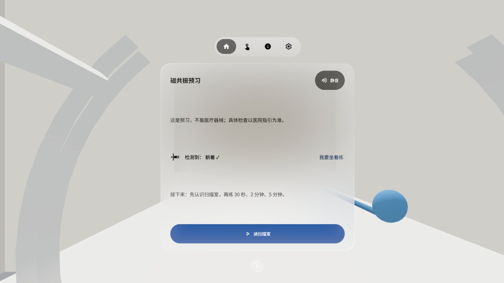 准备（躺姿）：机架在头顶，窗口识别你是躺着还是坐着 | 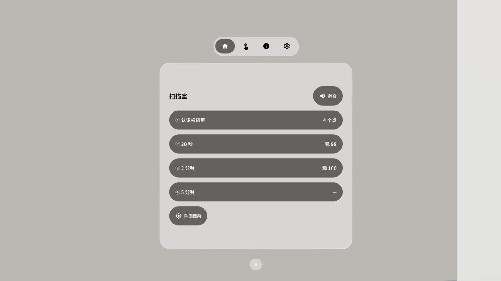 扫描室：认识扫描室 + 三关，静音一眼可见 |
| 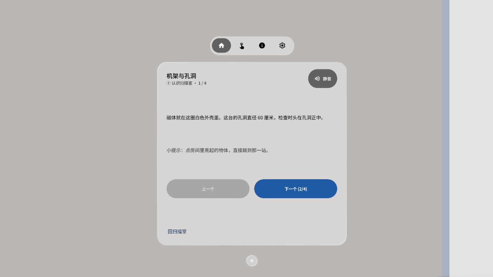 导览：机架与孔洞 | 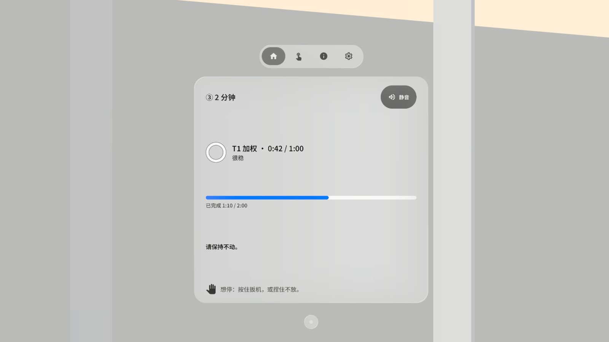 扫描中：T1 加权序列，进度和「请保持不动」 |
| 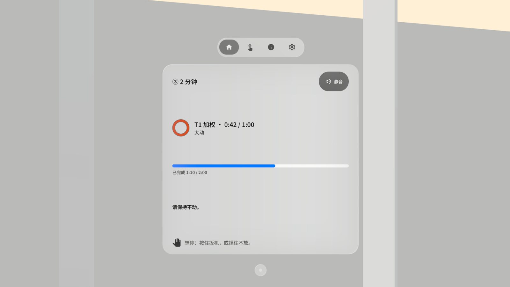 动了提醒：静止环变红 | 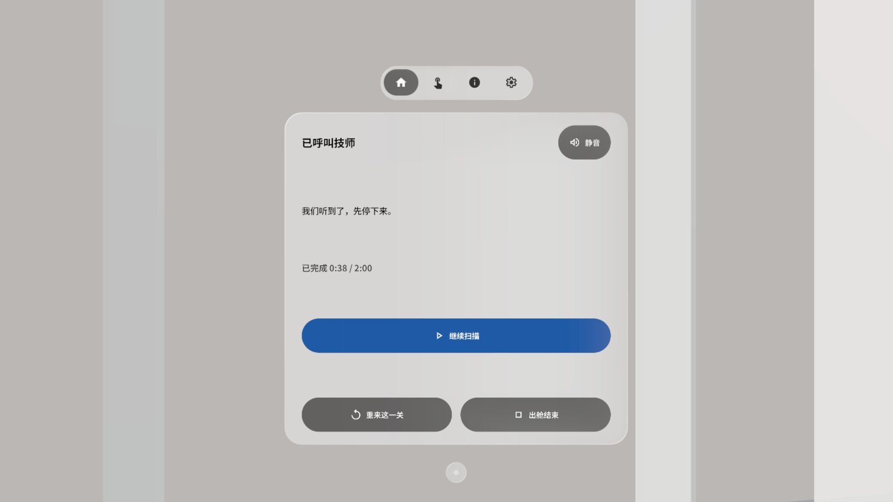 呼叫技师：扫描停、台子滑出 |
| 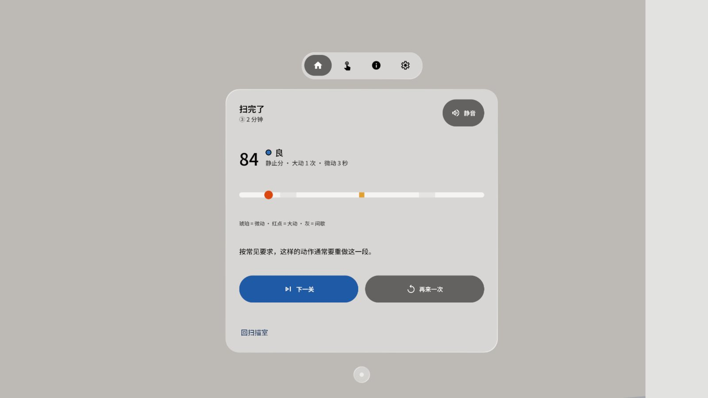 结果：84 分「良」，时间线标出动的那几下 | |

截图来自 PICO Emulator 6.1（Graphics: High Definition），由调试广播跳到各个状态，**不是真实手势录像**。v0.1.1 演示视频（v0.1.1 Release 附件 `video-01.mp4`，54 秒，无声，英文界面）也是模拟器上调试输入驱动的，**非真实手势录像**。

### 已知问题

- 仰躺时窗口开在脸的正上方（按开窗时的视线摆放）；低头或抬头时打开的窗口，回到平视后仍停在开窗处、并朝着当时的视线。点设置里的 [叫回面前] 或拖动系统窗口即可。
- 按 HOME 后扫描室会关掉，窗口留在主空间、计时停住；从启动器再点一次应用，扫描室回来、从原处继续。
- 模拟器上从点图标到窗口出现约 3.3 s（进程冷启动约 2.5 s），真机时间没测。

### 还没在真机上验证的

v0.1.3：坐着进扫描室再躺下，机架是否正好在头顶；躺在孔里读数条四角与孔壁、条离眼 0.27 m 是否吃力；躺姿窗口和读数条是否重叠；扫描声听感。此前各版：手柄实体 B 键和返回键（模拟器只能注入按键）、真人躺姿下开窗的位置和舒适度、头显上低头 / 抬头时冷启动窗口出现的时间和摆位、扫描噪声的真机听感和响度、真机抖动下 4 mm / 1.5° 阈值会不会误报。

## English

Rehearse an MRI scan at home. Lying on your own bed (or sitting), a life-size MRI scanner slides you into its 60 cm bore, the scan noise plays, and the headset measures how many millimetres and degrees your head moves. Take the room tour first, then practise stillness over three levels: 30 s → 2 min → 5 min.

- **Room tour**: the gantry, the bore, the head coil, the call ball and the control-room window light up one by one while the window explains them
- **Three stillness levels**: slide in → positioning countdown → scan sequences, with gaps where a caption warns "next one is louder / about the same / quieter"
- **Call the technologist any time**: pinch and hold 0.4 s (or hold the controller trigger); the scan stops and the table slides out, with Resume / Restart this level / Finish
- **Results**: stillness score, grade and a timeline marking each movement, then next level or retry
- **One system window**: native tabs (Scan / How to / About / Settings), moved and closed with the system controls under it; after closing it, tap the "Open panel" chip in the scene or press BACK / controller B to open it again
- **Settings**: Bring back in front, Quit app; Chinese / English, 60 / 70 cm bore, movement hints, head coil, skip the slide animation, three-step volume; mute is always visible and remembered
- Offline, no account, no permissions

### What changed in v0.1.3

- Headset feedback said the gantry / bore above the head was in the wrong place → the bore is re-placed from your head pose when a scan starts or restarts, so if you enter the scan room sitting and then lie down, the gantry follows to above your head (v0.1.2)
- Lying in the bore, the corners of the readout strip cut into the bore wall → the strip height is now solved from its four corners (60 / 70 cm, lying / sitting, head off by ±3 cm: all ≥ 1.5 cm clear of the wall); the strip is about 0.27 m from the eyes
- Passed emulator QA round 8; not yet verified on a headset

### What changed in v0.1.1

- Native system window and native tabs; system move / close; the custom drag bar is gone
- Cold start, the "Open panel" chip and Bring back in front open the window straight away, wherever you look
- BACK / controller B never quits the app (it reopens the window when it is closed)
- The six scan-room sounds are CC0 recordings of a real MRI scanner from freesound
- The English tour no longer truncates; a pinch no longer passes through the window to the wall behind it

### Screenshots

| | |
|---|---|
|  Ready (lying down): the gantry above you; the window detects lying or sitting | 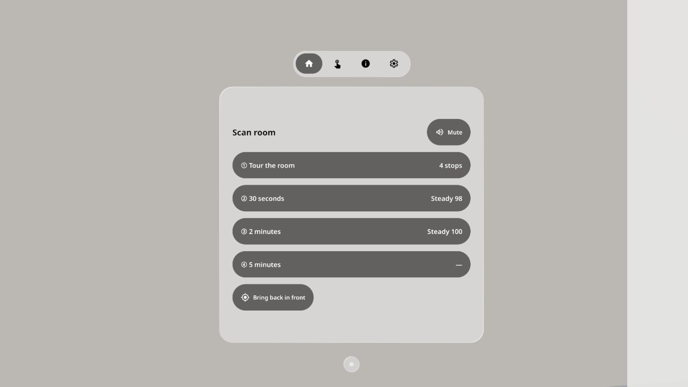 Scan room: tour + three levels, mute always visible |
| 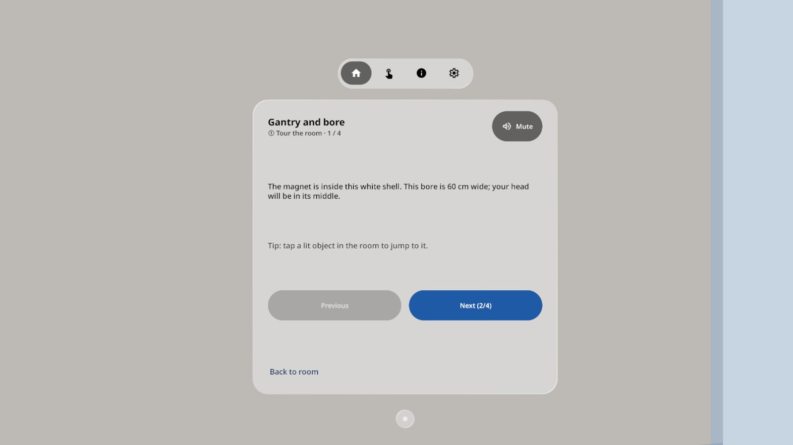 Tour: gantry and bore | 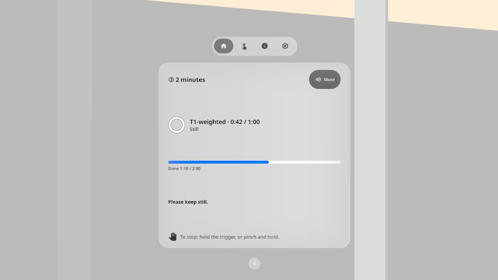 Scanning: T1 sequence, progress and "Please keep still" |
|  Movement alert: the stillness ring turns red | 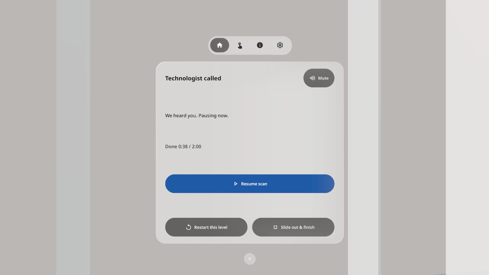 Technologist called: the scan stops, the table slides out |
| 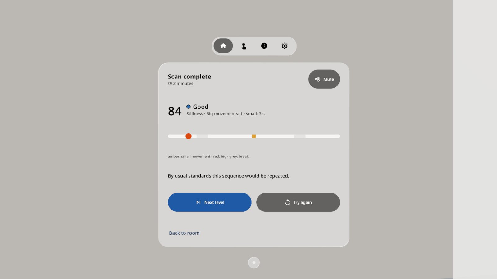 Result: 84, "Good", with the movements on the timeline | |

Screenshots come from PICO Emulator 6.1 (High Definition graphics), jumped to each state by the debug broadcast — **not a recording of real hand input**. The v0.1.1 demo video (`video-01.mp4` on the v0.1.1 release, 54 s, silent, English UI) is also driven by debug input on the emulator — **not real hand input**.

### Known issues

- Lying on your back, the window opens right above your face (it is placed along your gaze when it opens); a window opened while looking down or up stays there, facing that gaze, after you look ahead again. Use Settings → Bring back in front, or drag the system window.
- After HOME the scan room closes while the window stays in the home space with the timer paused; tap the app in the launcher again and the room comes back where you left off.
- On the emulator the window appears about 3.3 s after tapping the icon (process cold start is about 2.5 s); not measured on a headset.

### Not yet verified on a headset

v0.1.3: whether the gantry ends up right above your head when you enter sitting and then lie down; the readout strip corners against the bore wall and whether 0.27 m from the eyes is comfortable; whether the lying window overlaps the strip; how the scan noise sounds. From earlier versions: The physical controller B and BACK keys (the emulator only injects key events), where the window opens and how comfortable it is when really lying down, how fast and where the window appears on a cold start while looking down / up on a headset, how the scan noise sounds and how loud it is, and whether the 4 mm / 1.5° thresholds false-alarm with real head jitter.

## Build

See [AGENTS.md](AGENTS.md) for the build command, code layout, the debug broadcast and the screenshot list.

```bash
./gradlew assembleDebug testDebugUnitTest
./gradlew assembleRelease   # unsigned, for the Vibe Lab listing
```

## Credits / 致谢

- Scan-room sounds / 扫描室声音: "MRI fsk robot servo.wav" by parabolix (https://freesound.org/people/parabolix/sounds/320532/) and "motor adjustable bed.wav" by kedarda (https://freesound.org/people/kedarda/sounds/613865/), both Creative Commons 0 (CC0), trimmed, denoised and looped. The call and movement tones are synthesised.
- Fonts / 字体: Noto Sans and Noto Sans SC, SIL Open Font License 1.1.

## License

Private, all rights reserved. Bundled fonts are under the SIL Open Font License 1.1; the scan sounds are CC0 (see Credits).
