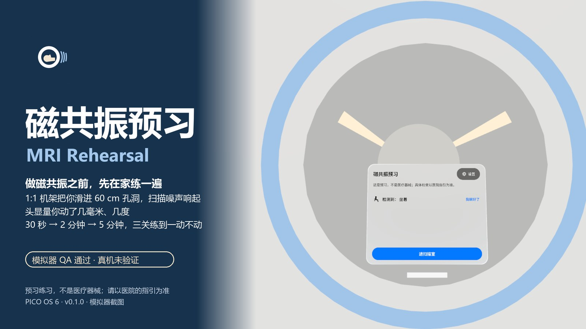
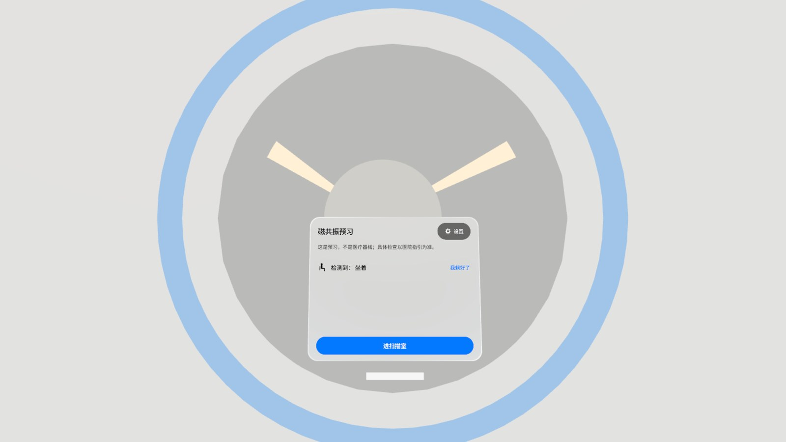
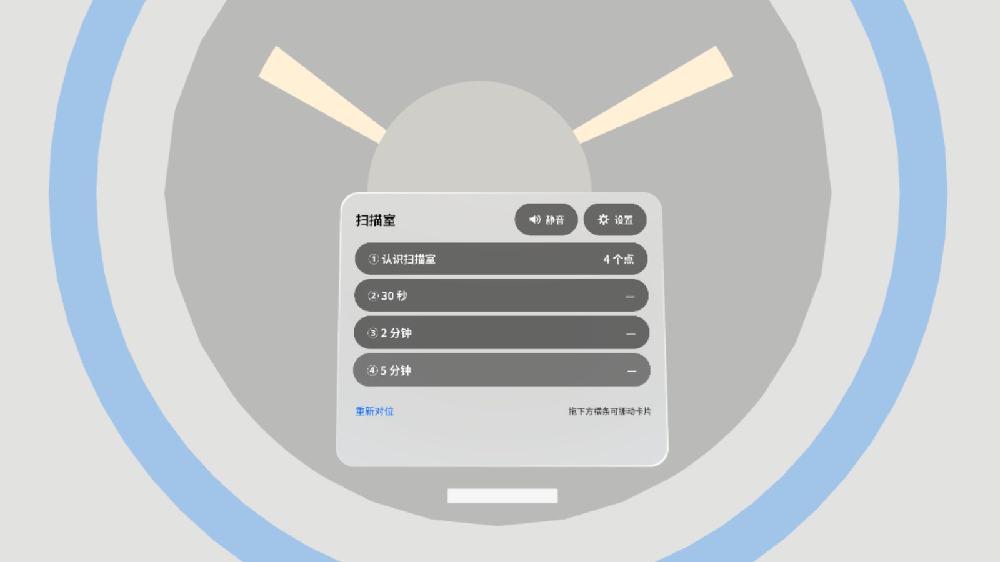
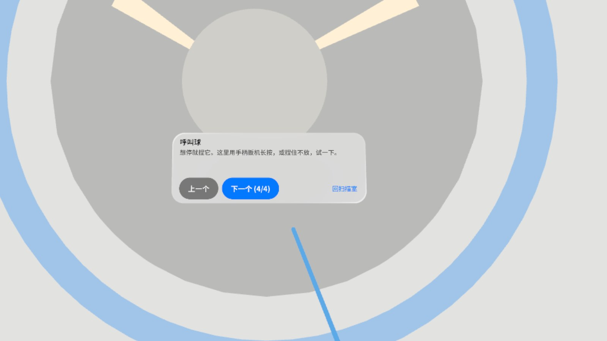
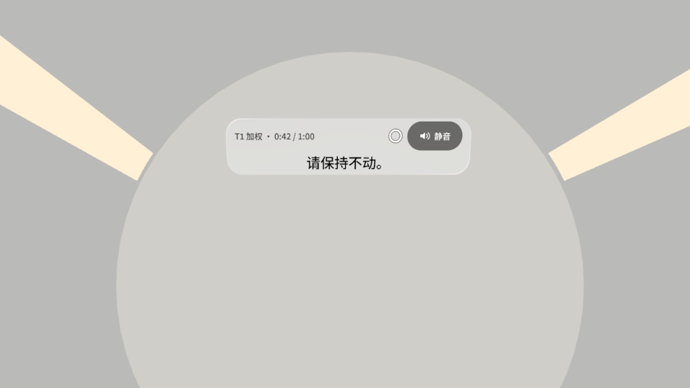
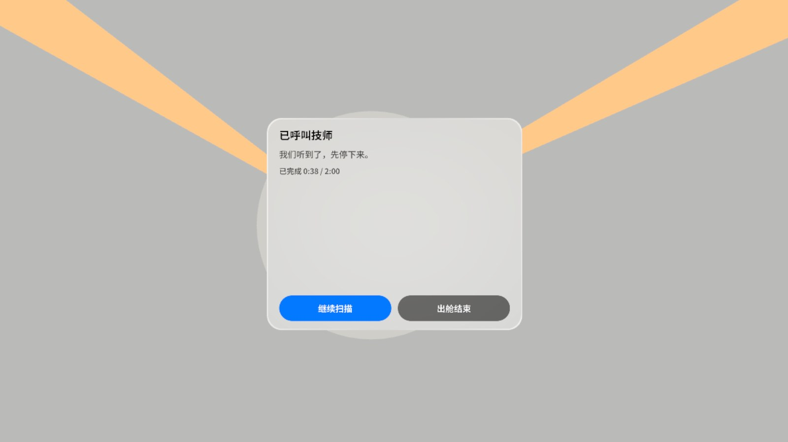
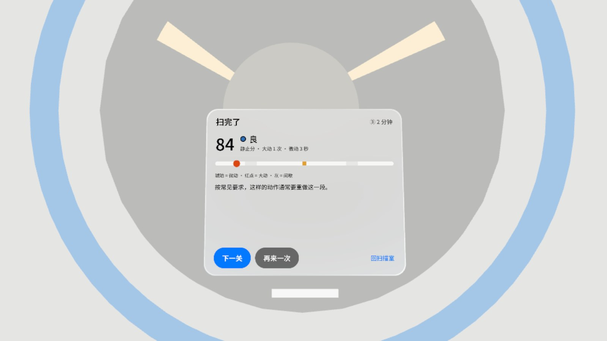

# 磁共振预习 MRI Rehearsal

> **预发布 v0.1.0 · 模拟器 QA 通过，真机未验证。** Pre-release v0.1.0: passed emulator QA, not yet verified on a headset.
>
> 这是一个预习练习，**不是医疗器械**；扫描当天请以医院和技师的指引为准。
> This is a rehearsal, **not a medical device**; on the day, follow your hospital's instructions.

<p align="center"></p>

## 中文

做磁共振之前，先在家练一遍。躺在自己床上（或坐着），一台 1:1 的磁共振机把你滑进 60 cm 的孔洞，扫描噪声响起，头显量你的头动了几毫米、几度。先认识扫描室，再按 30 秒 → 2 分钟 → 5 分钟三关，练到一动不动。

- **认识扫描室**：名签指着机架、孔洞、头线圈、呼叫球和技师窗，一站一站讲清楚
- **三关练静止**：入舱滑入 → 定位倒计时 → 几段扫描序列（中间有间歇，字幕提前说「下一段更响 / 差不多 / 轻一点」）
- **随时呼叫技师**：捏住 0.4 秒（或手柄扳机按住），扫描停、台子滑出，暂停卡给「继续扫描 / 出舱结束」
- **结果**：静止分 + 等级 + 时间线标出动的那几下，给下一关或再来一次
- **设置**：中英文、孔径 60 / 70 cm、动了提醒、头线圈、跳过导览、音量，全部可调；静音一眼可见并记住
- 卡片可拖动，「重新对位」把机架和卡片叫回面前
- 不联网、不需要账号、不申请权限；扫描噪声是程序合成的

### 截图

| | |
|---|---|
|  准备：机架横在面前，主卡识别你是坐着还是躺着 |  扫描室：认识扫描室 + 三关，静音和设置一眼可见 |
|  导览：名签和引线指着呼叫球 |  扫描中：躺在孔洞里，字幕条写着序列和进度 |
|  呼叫技师：扫描停、台子滑出 |  结果：84 分「良」，时间线标出动的那几下 |

截图来自 PICO Emulator 6.1（Graphics: High Definition），由调试广播跳到各个状态，**不是真实手势录像**。演示视频（Release 附件 `video-01.mp4`，51 秒，无声）也是调试输入驱动的第 1 轮版本，**非真实手势录像**。

### 安装

从 [Release v0.1.0](https://github.com/kejing-dev/MriRehearsal/releases/tag/v0.1.0) 下载 `MriRehearsal-v0.1.0.apk`，然后：

```bash
adb install -r MriRehearsal-v0.1.0.apk
```

```bash
pico-cli app launch io.embodit.mrirehearsal
```

需要 PICO OS 6（Spatial SDK 6.1.9），Full Space（Progressive，沉浸度 100 / 40 / 100）。

### 还没在真机上验证的

手柄射线拖动和扳机长按呼叫（模拟器不支持手柄）、真人躺姿下的追踪和舒适度、扫描噪声的听感和音量、表冠降沉浸度、真机抖动下 4 mm / 1.5° 阈值会不会误报。

## English

Rehearse an MRI scan at home. Lying on your own bed (or sitting), a life-size MRI scanner slides you into its 60 cm bore, the scan noise plays, and the headset measures how many millimetres and degrees your head moves. Take the room tour first, then practise stillness over three levels: 30 s → 2 min → 5 min.

- **Room tour**: tags point at the gantry, the bore, the head coil, the call ball and the control-room window
- **Three stillness levels**: slide in → positioning countdown → scan sequences, with gaps where a caption warns "next one is louder / about the same / quieter"
- **Call the technologist any time**: pinch and hold 0.4 s (or hold the controller trigger); the scan stops and the table slides out, with Resume / Finish on the pause card
- **Results**: stillness score, grade and a timeline marking each movement, then next level or retry
- **Settings**: Chinese / English, 60 / 70 cm bore, movement hints, head coil, skip tour, volume; mute is always visible and remembered
- Cards can be dragged; Recentre brings the scanner and cards back in front of you
- Offline, no account, no permissions; the scan noise is synthesised

Screenshots come from PICO Emulator 6.1 (High Definition graphics), jumped to each state by the debug broadcast — **not a recording of real hand input**. The demo video (`video-01.mp4` on the release, 51 s, silent) is also debug-driven and shows the round-1 build — **not real hand input**.

### Install

Download `MriRehearsal-v0.1.0.apk` from [Release v0.1.0](https://github.com/kejing-dev/MriRehearsal/releases/tag/v0.1.0), then:

```bash
adb install -r MriRehearsal-v0.1.0.apk
```

```bash
pico-cli app launch io.embodit.mrirehearsal
```

Requires PICO OS 6 (Spatial SDK 6.1.9); Full Space (Progressive, immersion 100 / 40 / 100).

### Not yet verified on a headset

Controller-ray drag and trigger-hold call (the emulator has no controller), tracking and comfort when really lying down, how the scan noise sounds and its volume, lowering immersion with the crown, and whether the 4 mm / 1.5° thresholds false-alarm with real head jitter.

## Build

See [AGENTS.md](AGENTS.md) for the build command, code layout, the debug broadcast and the screenshot list.

```bash
./gradlew assembleDebug testDebugUnitTest
```

## License

Private, all rights reserved. Bundled fonts Noto Sans / Noto Sans SC are under the SIL Open Font License 1.1.
